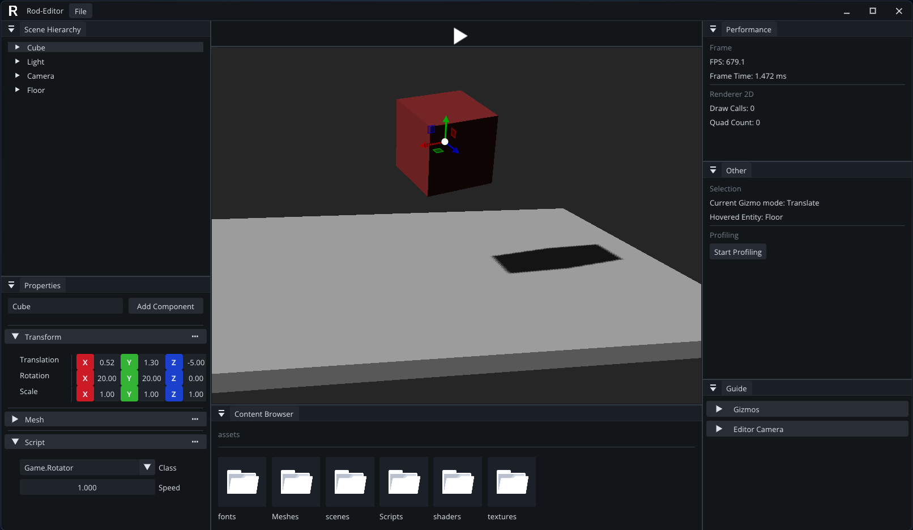

<div align="center">
  

# RodEngine

**C++23 game engine · OpenGL 4.6 · C#/.NET 9 scripting · Scene editor**

</div>

C++ game engine and editor for 2D/3D scenes. ECS architecture, OpenGL renderer, C# scripting, scene serialization, standalone runtime.

**Status:** In development. Physics, audio, animation, and prefabs not implemented.



## Features

**Editor**
- Dear ImGui docking, viewport, entity list, component inspector, content browser
- Entity picking, transform gizmos, asset drag-and-drop
- Scene creation, loading, saving, isolated play mode

**Rendering**
- OpenGL 4.6 backend
- 2D sprite batching, textures, tinting, tiling
- Static GLB meshes, materials, directional lighting, shadow maps
- GLSL → SPIR-V compilation, shader caching

**Scenes**
- EnTT ECS, UUID-based entities, component system
- YAML scene serialization (`.rod`)
- Perspective and orthographic cameras

**Scripting**
- C# scripting via hosted .NET 9 runtime
- C++/C# interop, entity and component APIs
- Script fields in inspector, assembly reloading

**Runtime**
- Separate runtime executable
- Scene and asset export from editor

## Project Structure

| Directory | Purpose |
|---|---|
| `RodEngine/` | Core engine, rendering, ECS, scripting |
| `Rod-Editor/` | Editor, panels, scene assets |
| `Rod-Runtime/` | Standalone scene runner |
| `Rod-ScriptCore/` | C# API and native interop |
| `cmake/` | Build configuration, dependencies |
| `tests/` | Catch2 unit tests |

**Dependencies:** GLFW, Glad, Dear ImGui, ImGuizmo, EnTT, GLM, shaderc, yaml-cpp, tinygltf, stb_image, spdlog.

## Build

### Requirements

- **Common:** CMake 3.25+, Git, Python 3, .NET 9 SDK
- **Graphics:** OpenGL 4.6-capable GPU and driver
- **Windows:** Visual Studio 2022, Desktop development with C++
- **Windows Clang:** LLVM, Ninja, x64 Visual Studio developer environment
- **Linux:** Clang, Ninja, OpenGL/X11 development packages, Zenity for file dialogs

Linux: X11 or XWayland; no native Wayland backend.

### Clone

```bash
git clone --recurse-submodules https://github.com/Plecaj/RodEngine.git
cd RodEngine
python RodEngine/vendor/shaderc/utils/git-sync-deps
```

### Configure & Compile

| Toolchain | Configure | Build (Debug) |
|---|---|---|
| Windows / MSVC | `cmake --preset vs` | `cmake --build --preset vs-debug` |
| Windows / Clang | `cmake --preset windows-clang` | `cmake --build --preset windows-clang-debug` |
| Linux / Clang | `cmake --preset linux-clang` | `cmake --build --preset linux-clang-debug` |

Build configurations: `Debug`, `Release`, `Dist`.

## Usage

### Run Editor

Executable locations:
- **MSVC:** `build/vs/bin/<configuration>/`
- **Clang:** `build/clang/bin/<configuration>/`

Linux / Clang example:

```bash
cd build/clang/bin/Debug
./Rod-Editor
```

Run from the executable directory; assets loaded relative to the working directory.

**Sample scenes:** `assets/scenes/Example.rod`, `assets/scenes/Example3D.rod`.

The editor opens `Example3D.rod` on startup. Other scenes: **File → Open**.

### Export

**Editor:** File → Export game
- Current editor scene + assets
- Output: `exports/RodGame/`, relative to the editor working directory

**CMake:**

```bash
cmake --build build/clang --config Debug --target RodGame-Export
```

- Bundled `Example3D.rod` as startup scene
- Output: `build/clang/export/RodGame/`

Replace `build/clang` with `build/vs` for MSVC.

## Tests

Catch2 + CTest. Math, scenes, serialization, rendering utilities, scripting interop.

Linux / Clang:

```bash
cmake --preset linux-clang-tests
cmake --build --preset linux-clang-tests
ctest --preset linux-clang-tests
```

Other presets: `vs-tests`, `windows-clang-tests`.

Linux sanitizer configuration: `linux-clang-sanitizers` (ASan, LSan, UBSan).

GitHub Actions: Windows MSVC, Windows Clang, Linux Clang, Linux sanitizers.

## License

[Apache-2.0](LICENSE). Third-party dependencies and assets retain their respective licenses.
